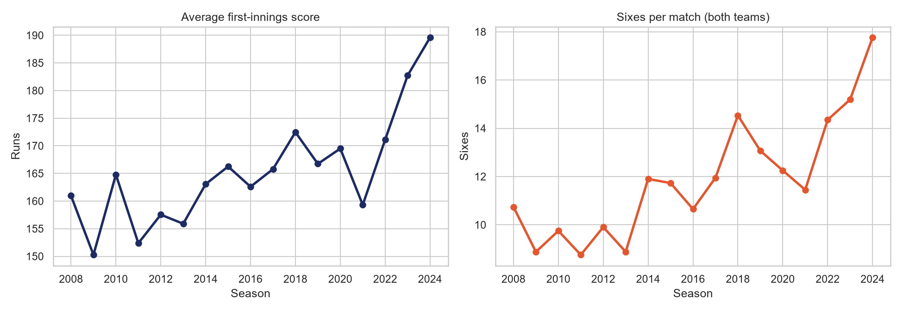
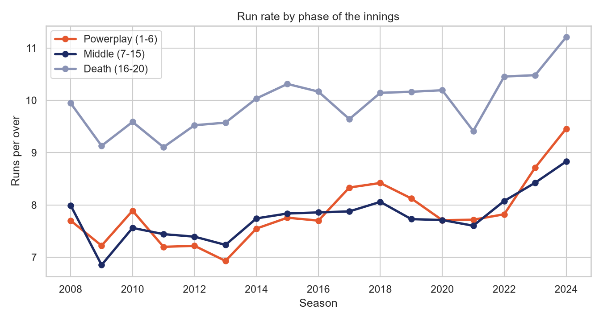
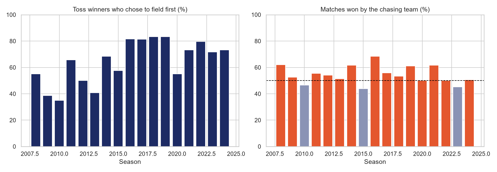
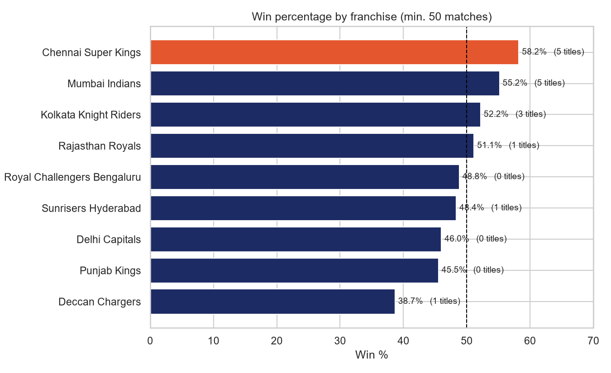
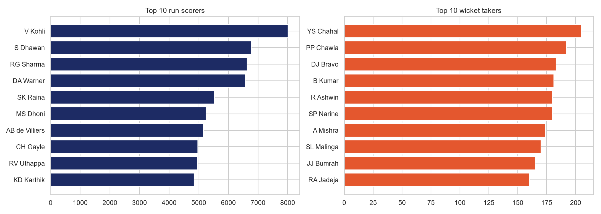
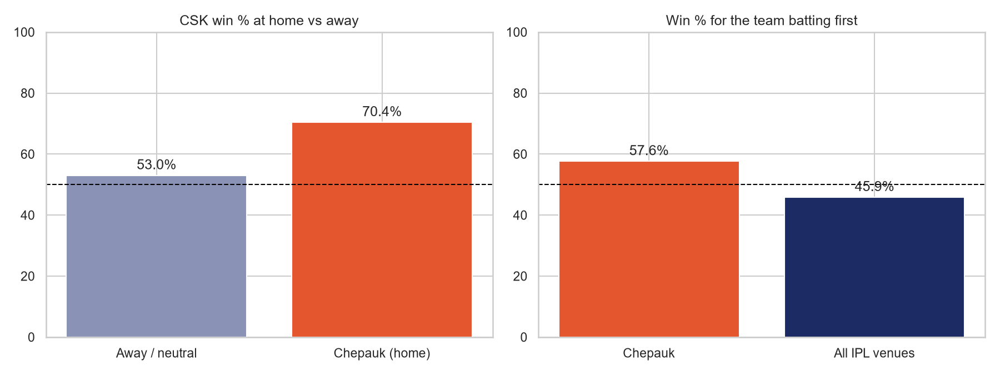
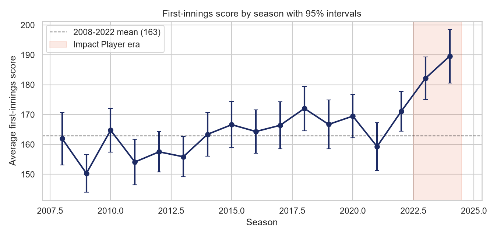
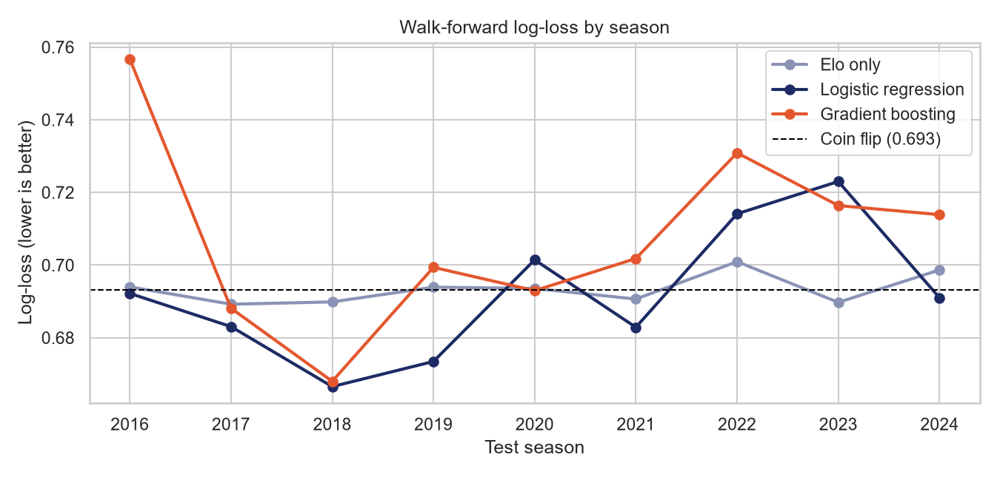

# IPL Cricket Data Analysis (2008 to 2024)

I follow cricket closely, so I used real data to test some things people often say about the IPL: that scores keep getting bigger, that the toss decides matches, and that Chepauk is a fortress for Chennai Super Kings. This project analyses every IPL match from 2008 to 2024 (1,095 matches and about 260,000 deliveries) using Python.

The project has two notebooks and an interactive dashboard:

1. [`ipl_analysis.ipynb`](ipl_analysis.ipynb) describes what happened (scoring trends, toss, teams, players, Chepauk).
2. [`ipl_inference_and_prediction.ipynb`](ipl_inference_and_prediction.ipynb) asks which of those findings are statistically real, and whether the winner can be predicted before a match.
3. **[Interactive dashboard](https://Black-Pearl007.io/ipl-cricket-analysis/)** lets you explore the results without running any code: pick a range of seasons, a team or a ground, and the charts and confidence intervals update. GitHub shows both notebooks directly in the browser.

## Key findings

**1. Scoring has jumped, especially recently.**
The average first-innings score rose from 161 in 2008 to 190 in 2024. Most of that rise came in the last two seasons: the 2008 to 2022 average was about 163, and the 2023 and 2024 average was about 186. Sixes per match went from 10.7 to 17.8.



**2. The powerplay changed the most.**
Comparing the 2008 to 2022 average with 2024, the powerplay run rate rose from 7.69 to 9.46 runs per over (+1.77). The middle overs rose from 7.67 to 8.83 (+1.16) and the death overs from 9.83 to 11.21 (+1.38).



**3. The toss barely matters, but chasing has been slightly better.**
Teams that won the toss won the match only 50.8% of the time, which is almost a coin flip. The chasing team won 54.1% of decided matches, and chasing teams won more than half the matches in 12 of 17 seasons. Captains have noticed: toss winners chose to field 43% of the time in 2008 to 2010, and 75% of the time in 2022 to 2024.



**4. CSK and Mumbai Indians have been the most consistent.**
Among franchises with at least 50 matches, CSK has the highest win rate (58.2%), followed by Mumbai Indians (55.2%) and Kolkata Knight Riders (52.2%). CSK and Mumbai have 5 titles each.



**5. Top performers.**
Virat Kohli leads all run scorers with 8,004 runs, ahead of Shikhar Dhawan (6,769) and Rohit Sharma (6,628). Yuzvendra Chahal leads wicket takers with 205, followed by Piyush Chawla (192) and Dwayne Bravo (183).



**6. Chepauk really is a strong home ground for CSK.**
CSK won 70.4% of its matches at Chepauk (71 matches) compared with 53.0% everywhere else. Unusually, the team batting first at Chepauk won 57.6% of matches, while across all IPL venues the team batting first wins only 45.9%. So the usual "chasing is better" pattern is reversed at this ground.



## Part 2: are the findings real, and can we predict matches?

The first notebook reports percentages. The second tests them with confidence intervals and corrects for running several tests at once (Holm-Bonferroni), then builds a win predictor evaluated on future seasons it never saw.

### Which findings hold up

| Claim | Result | 95% CI | Holm-adjusted p |
|---|---|---|---|
| Toss winner wins the match | 50.8% | 47.9% to 53.8% | 0.61 (no evidence of an effect) |
| Chasing team wins | 54.1% | 51.2% to 57.1% | 0.028 |
| Any team wins at its own home ground | 56.5% | 52.5% to 60.4% | 0.0075 |
| CSK win rate, Chepauk minus elsewhere | +17.4 points | +4.3 to +30.3 | 0.044 |
| Batting-first win rate, Chepauk minus elsewhere | +12.8 points | +1.7 to +23.8 | 0.047 |
| First-innings score, 2023-24 minus 2008-22 | +23.1 runs | +17.0 to +29.1 | 1e-12 |

The scoring jump is large and certain (Cohen's d = 0.75). The two Chepauk findings are real but fragile: they pass the correction only narrowly and their intervals are wide. The toss result means "no effect detected", not "no effect", because a sample this size could miss an advantage smaller than about 4 points.



### Can we predict the winner?

Mostly no, and that is the finding. Using only pre-match information (an Elo team rating, recent form, career record, home advantage, toss, venue tendency), trained on 2008 to 2022 and tested on 2023 and 2024:

| Model | Accuracy (144 matches) | Log-loss (coin flip = 0.693) |
|---|---|---|
| Coin flip | 51.4% | 0.693 |
| Better record so far | 56.9% | 0.684 |
| Elo only | 52.1% | 0.694 |
| Logistic regression | 52.1% | 0.704 |
| Gradient boosting | 50.7% | 0.709 |

No model can be told apart from a coin: every bootstrap interval for accuracy includes 50%, and every interval for the log-loss gain includes zero. A walk-forward check over nine seasons (2016 to 2024, 576 matches) gives the same picture: logistic regression reaches 54.7% accuracy and a log-loss of 0.692. Home advantage was the one consistent signal. More complex models did worse, which is expected with about 1,000 noisy examples.



## Interactive dashboard

The dashboard in [`docs/index.html`](docs/index.html) is a single self-contained page. It recalculates win rates and 95% confidence intervals for whatever seasons you select, and it shows the hypothesis tests and the prediction results from the second notebook. Every chart has a "View as table" option.

To view it locally, open `docs/index.html` in a browser. To publish it, push the repository to GitHub, then go to Settings, Pages, and choose the `main` branch and the `/docs` folder. The page then lives at `https://YOUR-USERNAME.github.io/ipl-cricket-analysis/`.

The dashboard is built from the data and from `results/results.json`, which the second notebook writes. To rebuild it after changing anything:

```bash
jupyter nbconvert --to notebook --execute --inplace ipl_inference_and_prediction.ipynb
python scripts/build_dashboard.py